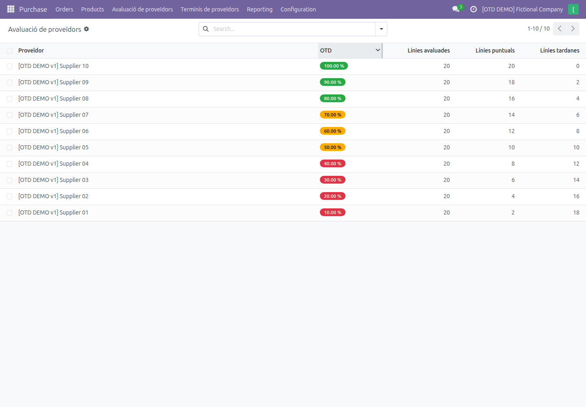
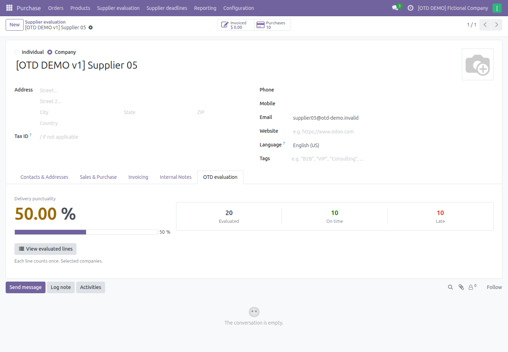
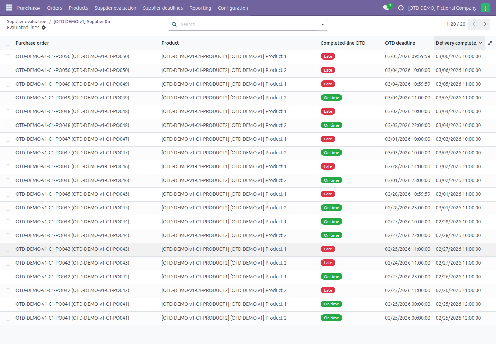

# Odoo Supplier Evaluation

**Supplier delivery performance for Odoo 18 Community — version 18.0.1.3.0.**

Measure on-time delivery (OTD) from completed purchase order lines, using
frozen delivery observations and explicitly confirmed supplier commitments.
Each evaluated line has the same weight, regardless of quantity or price.

## Features

- Supplier overview with sortable OTD percentages, evaluated/on-time/late
  counts, and a filter for OTD below 50%.
- Supplier dashboard with a prominent percentage, native progress bar and
  direct access to the purchase lines behind the result.
- **No data** (`Sense dades`) when no lines can be evaluated, rather than 0%.
- Original deadline preservation, deadline revision history and a manager
  workflow for confirming renegotiations with a justification.
- Immutable line, stock movement and receipt observations.
- Purchase permissions, record rules and selected-company boundaries apply
  to totals, filtering, sorting and drilldown.
- A dedicated evaluation action: standard Contacts views are preserved.
  Odoo's different, standard **On-time Rate** is hidden only in this action's
  supplier form.

Open **Purchase → Supplier evaluation**, then a supplier's
**OTD evaluation** tab. English is the source language; Catalan is provided
through Odoo's standard translation system. See [language setup](docs/I18N.md).

## Screenshots

All screenshots use fictional suppliers, products and company details.
The `.invalid` email addresses are demonstration placeholders.







## Video walkthrough

A YouTube walkthrough will be linked here when available.

<!-- Add the public YouTube video URL here after the video is published.
     Example markup: [Watch the walkthrough on YouTube](PUBLIC_VIDEO_URL)
     No video is generated or hosted by this repository. -->

## Requirements and installation

- A working **Odoo 18 Community** installation with its normal Python,
  PostgreSQL and system dependencies.
- Standard Odoo modules: `base`, `purchase`, `stock`, `purchase_stock`.
  Odoo installs their transitive dependencies automatically.
- No Enterprise modules, third-party addons, extra Python packages or
  custom JavaScript are required by this addon. Playwright is optional
  test tooling, not a runtime dependency. Docker is optional.

1. Copy `addons/supplier_evaluation` into your own custom addons directory,
   or add this repository's `addons` directory to your existing `addons_path`.
   Keep Odoo's standard addon paths as well.
2. Restart Odoo, enable developer mode and update the Apps list.
3. Search for **Supplier Evaluation** (remove the default Apps filter if
   needed) and install it. Give the intended users Purchase access.

Alternatively, with a configured Odoo installation and a **new test database**:

```sh
odoo-bin -c /path/to/odoo.conf -d supplier_evaluation_otd_test \
  -i supplier_evaluation --without-demo=all --stop-after-init
```

The configuration must include the addon path and PostgreSQL connection.
Packaged installations may name the executable `odoo` instead of `odoo-bin`.
For an existing deployment, back up its database and filestore and validate
`-u supplier_evaluation` on a separate copy before upgrading production.

See [installation and optional Docker setup](docs/INSTALLATION.md).
Installing the module never runs the optional demonstration generator.

## How OTD works

```text
OTD (%) = on-time completed lines / evaluated completed lines × 100
on time = completion timestamp <= accepted deadline + 24 hours
```

The 24-hour tolerance is inclusive. A completion exactly at the boundary is
on time; one second beyond it is late. Datetimes are stored in UTC and
shown in the user's Odoo timezone.

A line is captured once when a validated receipt first brings its received
quantity up to the ordered quantity. Partial receipts do not count until
the line is complete. The applied deadline is the latest eligible,
explicitly confirmed renegotiation recorded before completion; otherwise,
the recorded original commitment is used. Editing `date_planned` alone
cannot change the accepted deadline.

A later renegotiation, return or quantity edit does not rewrite the frozen
observation. Incomplete lines, cancelled orders and observations with
insufficient data are excluded from the supplier percentage. The captured
supplier and currently selected, permitted companies determine attribution.
There is no automatic rollup across parent/child contacts.

## Renegotiations and immutable history

Technical deadline revisions and confirmed agreements are separate records.
Only Purchase managers can confirm an eligible revision; a justification
and an explicit supplier-attribution choice are required. Historical
records and snapshot fields reject ordinary edits, deletion and copying,
including elevated ORM calls where guarded by the module.

This is application-level audit history, not a tamper-proof ledger against
administrators with direct PostgreSQL access. Existing completed lines
without trustworthy captures are not retroactively scored.

See [technical module documentation](addons/supplier_evaluation/README.md)
and [access control and security](SECURITY.md).

## Validation

- **138 integration tests** passed on an isolated copy for the final UI.
- **47 local tests** cover deadline persistence, classification, demo plans
  and safety/version guards without a database.
- Chromium verified all ten fictional suppliers (10%–100%), native sorting,
  filtering, dashboard rendering, standard-form isolation and drilldown.
  Supplier 05 has 20 evaluated lines: 10 on time and 10 late (50%).
- Fresh-install validation and its exact environment/results are recorded
  in [the publication audit](docs/PUBLICATION_AUDIT.md).

Commands and scope: [testing guide](docs/TESTING.md). Historical validation
records remain under `tests/`; local dumps, credentials and raw logs are
excluded from Git.

## Known limitations

- Targets Odoo 18 Community; other major versions and Enterprise are not
  certified. Validation covers the specific build recorded in the audit.
- English and Catalan are supplied; other module translations are not included.
- No historical backfill or retrospective rewriting of completed outcomes.
- No quantity/value weighting, financial scoring or automatic parent-company
  supplier consolidation. Odoo's standard On-time Rate uses another formula.
- No large-dataset performance benchmark or mobile browser certification.
- The optional demo generator uses fixed historical dates and intentionally
  restricted database names. Its original ORM generation was validated on
  18.0.1.2.0; the 1.3.0 compatibility gate is covered locally, but generation
  was not rerun during publication preparation.

## Repository

| Path | Purpose |
| --- | --- |
| `addons/supplier_evaluation/` | Installable Odoo addon and integration tests |
| `docs/` | Installation, testing, publication audit and fictional screenshots |
| `tests/` | Local tests, optional browser checks and historical reports |
| `scripts/` | Optional, guarded ORM demo generator |
| `docker-compose.yml`, `compose.demo.yml` | Optional local environments |

[Demo guide](DEMO.md) · [Contributing](CONTRIBUTING.md) ·
[GitHub description and topics](docs/GITHUB.md)

## License

[GNU LGPL version 3](LICENSE), matching the addon manifest (`LGPL-3`).
The referenced GPL version 3 text is included in [COPYING](COPYING).
Odoo is a separate dependency with its own notices and licenses.
